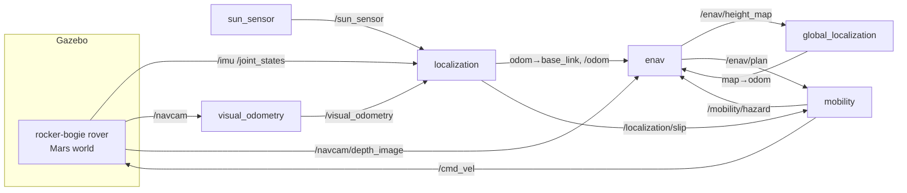

# WATO x UWRT Mars Rover Autonomy

A ROS 2 navigation stack that works the way NASA's Perseverance rover navigates, running against a procedurally generated Mars world in Ignition Gazebo. Everything runs in Docker, including on an Apple Silicon Mac.

| Perseverance | This repo |
| --- | --- |
| ENav: candidate path tree, cheap ranking, then ACE on the best few | `enav` + `rover_core/planner`, `rover_core/ace` |
| ACE (Approximate Clearance Evaluation, Otsu et al. 2020) | Closed-form interval bounds on rocker, bogie, tilt and belly clearance |
| Stereo navcam → 2.5D height map | Mast RGB-D navcam → rolling 5 cm height map |
| Visual odometry overriding wheel odometry | `visual_odometry` (ORB + PnP/RANSAC) replaces wheel motion over each VO interval |
| IMU + sun finding for attitude | Gyro + gravity + sun sensor attitude filter (Mahony, TRIAD init) |
| Slip, tilt and suspension fault protection | `mobility` fault monitor, stop and wait for the ground (or auto back-out) |
| Orbital map localization (HiRISE / Mars Global Localization) | `global_localization`: local height map matched to an orbital DEM |
| No GPS | No GPS |

## Quick start

1. Install [Docker Desktop](https://www.docker.com/products/docker-desktop/) (Mac) or Docker Engine (Linux). On a Mac, give Docker at least 8 GB of memory (Settings → Resources).
2. Build and start the simulator, the rover and Foxglove:

   ```bash
   ./watod build
   ```

   ```bash
   ./watod up
   ```

   The first build takes a while: it pulls `ros:humble-ros-base`, installs Ignition Fortress and generates the Mars world.
   - `PLATFORM="local"` in `watod-config.sh` uses a public base image, so no GHCR login is needed. Set it to `arm64`/`amd64` to use the WATonomous images instead.
   - Without a GHCR login, the build prints `failed to configure registry cache importer ... 403`. That is only the optional remote build cache; the build continues.
3. Watch it:
   - **Foxglove**: open [Foxglove](https://app.foxglove.dev), *Open connection* → `ws://localhost:<FOXGLOVE_BRIDGE_PORT>` (the port is in `modules/.env`), then *Import layout* → `config/rover_foxglove_config.json`.
   - **Gazebo**: open [app.gazebosim.org/visualization](https://app.gazebosim.org/visualization) and connect to `ws://localhost:<GAZEBO_PORT>`.

The default scenario is a long traverse: the rover spins once in place to map its surroundings, then drives to six waypoints on its own. Pick another with the `SCENARIO` variable, e.g. `manual` to choose the goals yourself:

```bash
SCENARIO=manual ./watod up
```

| Scenario | What it shows |
| --- | --- |
| `traverse` | ~120 m loop over six waypoints: route planning around craters, odometry drift and orbital fixes. The dune is a ground-planned keep-out zone. |
| `manual` | No waypoints: after its startup panorama the rover waits for you to click a goal. |
| `rock_field` | Straight into a dense rock field: ACE threads between rocks it cannot straddle. |
| `sand_trap` | A goal on the sandy flank of a dune (~14–15° there, which ACE accepts) with no keep-out zone. The sand is meant to be too loose to climb, so slip detection should stop the rover, then it backs out and marks the hazard. See *Simulation notes*: in Gazebo the sand has not actually cost the rover traction so far. |

## Reading the 3D view

| What you see | Meaning |
| --- | --- |
| Mars surface (`/sim/terrain`) | The simulator's true ground, rocks and sand, lit by the same sun as the navcam. It is for you, not the rover: the rover only knows what its camera and the orbital map show it, so any gap between the rover model and the surface is localization error. Published once (about 3.5 MB), so it adds no ongoing load |
| The rover model (body, mast, rockers, bogies, six wheels) | Drawn from its URDF with live joint angles, so you can watch the suspension articulate. The label above it says which goal it is on and how far away it is |
| Magenta pillar "GOAL n" | The waypoint it is driving to. Orange: upcoming waypoints. Grey: reached |
| Cyan line | The global route: cheapest path to the goal on the cost-to-go grid |
| Thick green line | The candidate path ENav chose this cycle; the rover drives its first arc |
| Thin red lines | Candidates ACE checked and rejected (too steep, too rough, or not enough clearance) |
| Grey squares (dark = low, light = high), off by default | The rover's height map from the navcam (`/enav/height_cloud`) |
| Faint coloured overlay at map height 0, off by default | Route cost: slopes, observed rocks, keep-out zones (`/enav/cost`) |

Turn layers on and off with the eye icons under *Topics* in the 3D panel's settings. The height map and the cost overlay are what the rover itself perceives; the terrain is what is really there.

## Operating the rover

- **Send a goal**: in Foxglove's 3D panel use *Publish point* (it publishes `/goal_point` in the `map` frame). This replaces the scenario's waypoints.
- **Clear a fault**: the rover stops on a fault and waits, like Perseverance waits for the ground team. Clear it with `ros2 service call /mobility/clear_fault std_srvs/srv/Trigger`. With `auto_recover: true` (scenario files) it backs out and retries by itself.
- **Look around**: `ros2 service call /mobility/panorama std_srvs/srv/Trigger` rotates the rover once in place.
- **Force an orbital fix**: `ros2 service call /global_localization/localize std_srvs/srv/Trigger`.

Open a shell in a running container with `./watod -t robot` (or `gazeboserver`).

## How it works



### The world (`src/common/rover_description`)

`tools/gen_world.py` builds everything from `config/world.yaml` and `config/rover.yaml` at build time:

- **Terrain**: smooth spectral-noise plains, craters with rims, a sand dune, and a flattened landing pad. Meshes are split into tiles because the renderer uses 16-bit vertex indices.
- **Rocks**: sizes drawn from the Golombek rock-abundance model used for Mars landing-site hazard analysis, with a dense rock field and a few boulders.
- **Surfaces**: soil, sand and rock each have their own friction. Sand is set to 0.18, which should be lower than the dune's steepest slope (~15°) needs; that is the intended sand trap.
- **Textures**: textured for visual odometry (Mars colors, pebbles, sand ripples), with Mars gravity and a sun that matches the sun sensor.
- **Orbital DEM**: a 25 cm/px map of the same terrain, blurred and noisy like a HiRISE product. The rover's only global reference.
- **Rover model**: a rocker-bogie rover with a differential (a small Gazebo plugin in `src/sim/rover_sim`), a mast navcam and an IMU.

### Localization: no GPS (`localization`, `visual_odometry`, `global_localization`)

- **Attitude**: the gyro is integrated and corrected toward gravity (roll, pitch) and the sun (heading). The filter's integral term learns the gyro bias. TRIAD initializes it from one gravity sample and one sun vector.
- **Position**:
  - Wheel odometry is integrated as it arrives.
  - When a visual odometry frame covers an interval, its translation replaces the wheel motion over that interval, as Perseverance does.
  - With all wheels still, VO is ignored (zero-velocity update).
- **Slip**: `1 − VO forward distance / wheel forward distance` over the last 0.6 m driven, signed. 0 is clean rolling, 1 is wheels spinning in place, above 1 is sliding back while the wheels drive forward.
- **Global fixes**: every 8 m, the local height map is matched against the orbital DEM.
  - Both are detrended (best-fit plane removed) and compared by normalized cross-correlation over ±2 m and ±3°.
  - A match must be distinct: `(1 − runner_up) ≥ 2 (1 − best)` for any peak 1 m or more away.
  - An accepted match replaces `map → odom`.

### ENav (`enav`, `rover_core`)

Each cycle (2 Hz), while the rover is still driving the previous arc:

1. **Height map**: navcam depth goes into a rover-centric 5 cm height map. Each cell keeps the most recent observation.
   - It is a rolling 12 m window (the camera sees ~7 m). Ground that falls out of the window as the rover moves is dropped, not stored.
   - What the rover needs to remember about the whole world is kept coarsely, in the 25 cm map-frame route cost below: rocks and steps it has seen, and keep-out zones. That's ~230 KB for the 60 m world.
   - ACE filters only the part of the window paths can reach (~4 m around the rover).
2. **Route cost** (map frame), combining:
   - slope cost from the orbital DEM;
   - step-height cost from what the rover has seen;
   - keep-out zones, from scenario files and from hazards found by faults.

   Dijkstra from the goal gives a **cost-to-go** for every cell.
3. **Path tree**: 972 fixed candidates: 12 turn-in-place headings × 9 × 9 curvatures for two 1.2 m arcs. Each is ranked by route cost plus cost-to-go at its endpoint, plus turn and heading-change penalties.
4. **ACE**: candidates are checked best-first; the first whose every pose passes wins.
   - For each wheel, the max-filtered height map gives an interval for the ground under it.
   - The intervals are pushed through the rocker-bogie linkage in closed form to bound pitch, roll, rocker and bogie angles and belly clearance.
   - Worst cases are compared against the limits in `rover.yaml`.
   - Unseen terrain is unknown, never assumed flat, except under the rover at startup.
5. **Mobility** turns in place to the chosen heading, then follows the first arc with pure pursuit.

### Fault protection (`mobility`)

| Fault | Trigger |
| --- | --- |
| Tilt | roll/pitch beyond 25° for 0.5 s |
| Suspension | rocker or bogie near its hard stop for 0.5 s (a bump off a rock edge is ignored) |
| Slip | slip magnitude above 60 %: spinning in place, or sliding |
| Stall | commanded wheel turning, measured wheel not, for 2 s |
| No safe path | ENav found no safe path for 10 cycles in a row |

On a fault the rover stops. With `auto_recover` it retraces its own trail backwards for up to 1 m (ground it has just driven over, so no blind turns). For slip, suspension and stall faults it also reports a 1.5 m keep-out zone to ENav. The 360° panorama only happens once, at startup on the flat landing pad: it is a blind turn ACE never checks. After `max_recoveries` attempts it waits for the ground. 30 s of fault-free driving restores the budget.

## Measured results

Simulation runs on an Apple M1 (Docker Desktop, software rendering). Errors are against Gazebo ground truth from the `eval` node.

| Scenario | Outcome |
| --- | --- |
| `traverse` | **All 6 waypoints reached** in ~6 min of sim time (133 m, moving 96 % of the driving time at ~0.39 m/s), no faults, at 0.99× real time with Foxglove attached. An earlier, slower run (14 min) had **one real slip fault** (61 %): it stopped, backed out and routed around. Final estimate error 0.20 m; odometry alone drifted 0.7 % of distance. Planning ~16 ms per cycle. |
| `rock_field` | Goal reached through the dense rock field, 32.4 m, no faults. Final estimate error 0.12 m, odometry alone 0.45 m (1.4 %). Run with `./watod up`. |
| `sand_trap` | Both waypoints reached with no faults: the sand did not cost traction in Gazebo (see *Simulation notes*). |

Across runs, odometry alone (wheels + VO) drifts roughly 0.5–3 % of distance driven. The deliberate 0.9 m landing-site error is removed by the first orbital fix, during the startup panorama.

## Development

```bash
MODE_OF_OPERATION=develop ./watod up
```

```bash
./watod -t robot_dev
```

Inside the container, `src/robot` and `src/common` are mounted at `/ament_ws/src`:

```bash
colcon build && colcon test && colcon test-result --verbose
```

Unit tests cover ACE (including a check that the bounds contain every exact configuration), the path tree, cost-to-go, the planner, the attitude filter, dead reckoning, slip, terrain matching, fault protection and the VO motion solver.

| File | What to change there |
| --- | --- |
| `src/common/rover_description/config/rover.yaml` | Rover geometry, sensors, ACE and fault limits (used by both the sim and the stack) |
| `src/common/rover_description/config/world.yaml` | Terrain, craters, dunes, rock abundance, sun, friction |
| `src/robot/bringup_robot/config/params.yaml` | Node parameters |
| `src/robot/bringup_robot/config/scenarios/*.yaml` | Waypoints, keep-out zones, auto-recovery |

## Simulation notes

- Performance on an M1 with Foxglove attached: the whole stack uses about 1.2 CPU cores (Gazebo ~100 %, robot nodes ~17 %, Foxglove bridge ~5 %) and runs at real time. What it took, biggest win first:

  | Change | Why |
  | --- | --- |
  | Shadows off (`sun.shadows` in `world.yaml`) | Gazebo renders in software inside Docker on a Mac; shadow passes doubled its CPU (~300 % → ~150 %). VO tracks the ground texture without them. |
  | `/clock` at 100 Hz (`rover_sim/SimClock`) | Gazebo's own `/clock` is sent every physics step (250 Hz) to every node running on sim time. |
  | Joint states at 25 Hz (`rover_sim/JointStates`) | Fortress's publisher sends them every physics step; this also halves `robot_state_publisher`'s TF traffic. |
  | JPEG navcam for Foxglove (`/navcam/image_viz/compressed`) | ~75 KB/s instead of ~1.2 MB/s of raw images over the websocket. |
  | Height cloud at 15 cm, every 2 s | ~40 KB/s instead of ~375 KB/s, and far fewer points for Foxglove to draw. |
  | 12 m height-map window; ACE crops to ~4 m | Less per-cycle work on map cells nothing reads. |
  | Navcam 320×240 at 5 Hz, physics at 4 ms | Keeps software rendering and physics cheap. |

  Everything uses sim time, so a slower machine only slows the run down.
- The rover drives at 0.4 m/s and turns in place at 0.6 rad/s, much faster than Perseverance (about 0.04 m/s), to keep demos short (`drive` in `rover.yaml`). At 0.5 m/s, bumps off rocks swing the bogies onto their stops.
- Depth comes straight from Gazebo's RGB-D camera instead of stereo matching.
- The sun sensor and the `eval` node read Gazebo ground truth (`/sim/*`). Nothing else does.
- Gazebo's diff drive commands wheel velocities with no torque limit, so wheels never stall in sim; stall detection matters on hardware.
  - A torque limit was tried. Wheels then saturate while skid-turning in place, and the drive reaction winds the bogies onto their stops.
- There is no sinkage, and in testing the sand's lower friction did not stop the rover climbing the dune: it stood on ~14° sand without sliding.
  - So the sand trap does not yet produce slip in simulation.
  - Slip detection (spin, slide back, slide forward) is covered by unit tests, and `/localization/slip` is live.
  - On hardware, or with a wheel–soil model, the same fault path applies.
- Teleporting the rover with Gazebo's `set_pose` service freezes camera rendering; restart the simulator instead.
